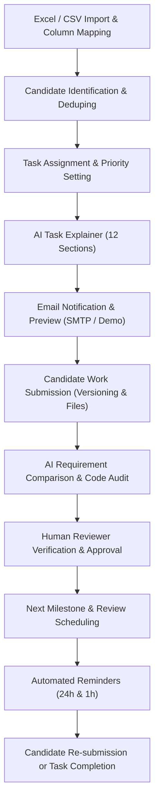

# 🤖 AI-Powered Recruitment Task Allocation, Progress Tracking, and Review Management System

A complete, production-grade web application for automating recruitment and internship task assignments, candidate tracking, AI-assisted explanations, requirement-by-requirement code reviews, reviewer decision workflows, and automated milestone scheduling.

---

## 🌟 Key Features & Workflow Architecture

The application implements the full 10-module lifecycle:



---

## 👥 User Roles & Access Control (RBAC)

Three distinct roles with tailored views and role-based route protection:

| Role | Username | Password | Capabilities |
| :--- | :--- | :--- | :--- |
| **Administrator** | `admin@demo.com` | `admin123` | Upload spreadsheets, map columns, assign tasks, view analytics, configure system settings, trigger AI explanations, dispatch notifications. |
| **Reviewer / Recruiter** | `reviewer@demo.com` | `reviewer123` | Inspect priority review queue, verify AI requirement comparisons, edit findings, add candidate action items, approve reviews, schedule follow-ups. |
| **Candidate** | `candidate@demo.com` | `candidate123` | View assigned tasks, read beginner-friendly AI breakdowns, upload project archives / repo links, track review milestones and scores. |

> **Tip:** The Login page features **1-Click Demo Login** buttons for instant role switching without typing credentials.

---

## 💻 Technology Stack

### Frontend
- **React 18** with **Vite**
- **Tailwind CSS** (Navy `#1e3a5f`, Lavender `#7c6fcd`, clean neutral accents)
- **Lucide React** icons
- **Recharts** (Task status distributions, submission trends, review completion gauges)
- **TanStack React Query v5** for server cache and data synchronization
- **React Hook Form** + **Zod** schema validation
- **React Hot Toast** for user feedback

### Backend
- **Python 3.13** + **FastAPI**
- **SQLAlchemy 2.0** ORM
- **SQLite** database (`recruitment.db`)
- **Pydantic v2** Settings & Schemas
- **JWT Authentication** (`python-jose`, `passlib`, `bcrypt`)
- **Pandas** & **OpenPyXL** for Excel and CSV ingestion
- **Google Generative AI (Gemini)** & **OpenAI** integration with structured JSON schemas
- **APScheduler** & background tasks for reminder dispatch
- **SMTP** service with fall-through **Demo Email Mode**

---

## 🚀 Quick Start Guide (Zero Node.js Required)

The application features an **Embedded Single-Server Architecture**: FastAPI serves both the REST API, interactive Swagger documentation, and the pre-compiled high-performance React SPA on port `8000`. **No Node.js or npm runtime is required.**

### 1. Prerequisites
- **Python 3.11+** (tested and verified on Python 3.13)

### 2. 1-Click Launch on Windows
Simply double-click:
- [`run.bat`](file:///C:/Users/sriva/.gemini/antigravity/scratch/recruitment-system/run.bat) (or [`run-all.bat`](file:///C:/Users/sriva/.gemini/antigravity/scratch/recruitment-system/run-all.bat))

This automatically initializes the virtual environment, installs Python packages, seeds default demo data, launches FastAPI, and opens your browser directly to:
- **Web Application UI:** `http://localhost:8000`
- **Interactive API Documentation:** `http://localhost:8000/docs`

---

### 3. Manual Command-Line Startup
```bash
# Navigate to the backend directory
cd backend

# Create and activate virtual environment (if not already created)
python -m venv .venv
.\.venv\Scripts\activate

# Install backend dependencies
pip install -r requirements.txt

# Seed initial database records
python -m app.seed_data

# Start the unified server
python -m uvicorn app.main:app --host 127.0.0.1 --port 8000
```
Open **`http://localhost:8000`** in any web browser.

---

## 🧪 Automated Testing & Verification

A comprehensive end-to-end test suite is included in `backend/test_api_workflow.py` which verifies all 9 core stages of the system:

```bash
cd backend
.\.venv\Scripts\python.exe test_api_workflow.py
```

### Verified Test Outputs:
```
--- 1. Testing Health Check ---
Health check PASS: {'status': 'ok', 'version': '1.0.0'}

--- 2. Testing Admin Login ---
Admin login PASS, token acquired.

--- 3. Testing Candidates API ---
Candidates fetch PASS: 6 candidates found.

--- 4. Testing CSV Import (Valid & Invalid) ---
Import preview PASS: 3 rows detected.
Valid Import PASS: 3 candidates imported.
Invalid import handled gracefully PASS: 3 rows rejected with specific validation errors:
  - Row 2: Missing candidate name
  - Row 3: Missing email address

--- 5. Testing Task AI Explanation ---
Task AI Explanation PASS:
  Demo Mode Flag: True
  Generated Title: [DEMO] Full-Stack Recruitment Portal Assignment

--- 6. Testing Candidate Login & Submissions ---
Candidate tasks fetch PASS: 1 tasks assigned.
Candidate work submission PASS: Submission ID generated, Version 2 recorded.

--- 7. Testing AI Evaluation Trigger ---
AI Evaluation PASS:
  Score: 72.0%
  Completed Features: 4
  Missing Features: 3
  Suggestions: 4

--- 8. Testing Reviewer Login & Approval Workflow ---
Reviewer pending queue PASS: 2 pending items.
Reviewer approval PASS: Official feedback published and next milestone scheduled.

--- 9. Testing Review Calendar & Reminders ---
Calendar events PASS: 3 reviews on schedule.
Reminders scheduled PASS: 2 pending reminders.

==========================================
ALL 9 WORKFLOW STAGES VERIFIED SUCCESSFULLY!
==========================================
```

---

## 📋 Comprehensive Module Reference

### Module 1: Excel / CSV Data Import
- **Upload formats:** `.xlsx`, `.xls`, `.csv`
- **Column Aliases:** Automatic case-insensitive mapping for `Candidate ID`, `Candidate Name`, `Email Address`, `Contact Number`, `Task Description`, `Required Modules`, `Deadline`, `Review Date`, `Reviewer Name`.
- **Validation:** Detects missing mandatory values, detects duplicate email IDs across the uploaded file or existing database, reports row-by-row error details, and supports an interactive 10-row preview before committing.

### Module 2: Candidate Management & Task Allocation
- Search candidates by Name, Email, or Reference ID.
- Displays current assignment status, reviewer, and timeline.
- Privacy protected: sensitive residential information is restricted to authorized admins and omitted from outgoing reminder emails.

### Module 3: AI Task Explainer
- Automatically translates raw task descriptions into a structured 12-section technical guide:
  1. Task title
  2. Task objective
  3. Problem statement
  4. Required modules
  5. Functional requirements
  6. Technical requirements
  7. Implementation plan
  8. Expected output
  9. Testing requirements
  10. Submission requirements
  11. Deadline
  12. Review schedule
- Human-in-the-loop: Administrator can edit and approve before sending.
- Features automatic fallback to **Demo Explainer Mode** with clear `[DEMO]` badges when no LLM API keys are set.

### Module 4: Task Email Notifications
- Formatted HTML email templates with task modules, deadlines, and direct login links.
- Interactive email preview modal before sending.
- Full email log history recording recipient, sent timestamp, delivery status, and error details.
- `DEMO_EMAIL_MODE=true` allows full workflow testing without SMTP credentials.

### Module 5: Automated Review Reminders
- Calculates and schedules reminders (e.g. 24 hours and 1 hour before reviews).
- View upcoming milestones on an interactive monthly Review Calendar.
- Statuses tracked: `pending`, `sent`, `cancelled`.
- Stops future reminders automatically once a task is marked `completed`.

### Module 6: Candidate Task Submission
- Drag-and-drop file upload accepting `.zip`, `.pdf`, `.docx`, `.txt`, `.py`, `.js`, `.ts` (up to 50 MB).
- Optional GitHub / GitLab repository URL.
- Implementation summary and notes.
- Automatic version history: uploading revised work creates `version 2`, `version 3` without overwriting previous versions.

### Module 7: AI-Powered Task Review & Code Audit
- Compares candidate code/files against task functional requirements.
- Outputs structured report:
  - Quality score gauge (0–100%)
  - Verified Completed Requirements with code evidence
  - Missing or Incomplete Requirements
  - Potential Bugs & Code Smells
  - Testing & Architectural Recommendations
- Clear `[DEMO MODE]` badge if executed without live LLM credentials.
- Untrusted input defense: Ignores prompt injection attempts embedded in uploaded candidate files.

### Module 8 & 9: Human Reviewer Approval & Next Milestone Scheduling
- Reviewer verifies and can override AI evaluation findings.
- Official reviewer feedback comments and actionable next-iteration items.
- Next review scheduling interface: sets follow-up date and time.
- Task completion checkbox: marks task as completed when all requirements are satisfied.

### Module 10: Reports & Dashboard Analytics
- Summary metric cards (Total Candidates, Active Assignments, Pending Reviews, Completed Tasks, Overdue Tasks).
- Recharts visualizations:
  - Task Status Distribution (Bar Chart)
  - Weekly Submission Trends (Line Chart)
  - Review Completion Ratios
- CSV Export: 1-click download of candidate progress and review reports.

### Module 11: Automated Code Runner & Test Execution Sandbox
- Sandboxed Python code execution service (`/api/v1/code-runner`).
- AST-level security audit: scans submitted code and flags dangerous operations (`eval`, `exec`, `__import__`, `subprocess`, file overrides).
- Unit test discovery & automated execution: detects `pytest` or `unittest` files in candidate submissions or executes custom test suites with timeout protection (5-second CPU limit).
- Execution report: returns status (`passed`, `failed`, `syntax_error`, `blocked_security`, `timeout`), return codes, standard output, and execution logs.
- Direct integration with AI evaluation to distinguish verified tested execution from static code analysis.

---

## ⚙️ Environment Variables Configuration

Copy `.env.example` to `.env` in the `backend/` directory:

```ini
# Database
DATABASE_URL=sqlite:///./recruitment.db

# Security
SECRET_KEY=dev-secret-key-change-in-production-use-32-chars-minimum
ALGORITHM=HS256
ACCESS_TOKEN_EXPIRE_MINUTES=480

# AI Configuration (Leave blank for Demo Mode)
AI_MODEL=gemini
GEMINI_API_KEY=
OPENAI_API_KEY=
AI_DEMO_MODE=true

# SMTP Configuration (Leave blank for Demo Email Mode)
SMTP_HOST=
SMTP_PORT=587
SMTP_USER=
SMTP_PASSWORD=
FROM_EMAIL=noreply@recruitment.com
DEMO_EMAIL_MODE=true

# Storage & Network
UPLOAD_DIR=uploads
CORS_ORIGINS=["http://localhost:3000","http://localhost:5173"]
```

---

## 📁 Project Structure

```
recruitment-system/
├── backend/
│   ├── app/
│   │   ├── api/
│   │   │   ├── auth.py              # Login, Registration, JWT
│   │   │   ├── candidates.py        # Candidate CRUD, Excel Import & Preview
│   │   │   ├── tasks.py             # Task lifecycle, AI explainer
│   │   │   ├── submissions.py       # File upload & version history
│   │   │   ├── evaluations.py       # AI requirements review & score
│   │   │   ├── reviews.py           # Review approval & scheduling
│   │   │   ├── notifications.py     # Email logs & user notifications
│   │   │   └── code_runner.py       # Module 11: Sandboxed code runner & test execution
│   │   ├── models/                  # SQLAlchemy ORM models
│   │   ├── schemas/                 # Pydantic v2 schemas
│   │   ├── services/                # Business logic, AI orchestration & code runner service
│   │   ├── utils/                   # Email service, Excel parser, upload utils
│   │   ├── config.py                # Environment configuration
│   │   ├── database.py              # SQLite session & metadata
│   │   ├── main.py                  # FastAPI application, SPA mount & lifespan
│   │   └── seed_data.py             # Default users, tasks, and submissions
│   ├── static/                      # Embedded pre-compiled React SPA (Zero Node.js runtime)
│   ├── sample_files/                # Test CSV & Excel files
│   ├── test_api_workflow.py         # End-to-end automated 11-stage test suite
│   ├── requirements.txt             # Python dependencies
│   └── .env.example
├── frontend/                        # React + TypeScript + Tailwind source code
│   ├── src/
│   │   ├── api/                     # Axios API clients
│   │   ├── components/
│   │   │   ├── common/              # FileUpload, StatusBadge, ProgressBar, Bell
│   │   │   ├── evaluation/          # AIReportCard
│   │   │   └── layout/              # Navbar, Sidebar, Layout
│   │   ├── pages/
│   │   │   ├── admin/               # Dashboard, CandidateList, ImportCandidates, TaskCreate,
│   │   │   │                        # TaskList, AIExplainer, EmailNotifications, ReviewCalendar,
│   │   │   │                        # Reports, Settings
│   │   │   ├── candidate/           # Dashboard, MyTasks, TaskView, SubmitWork, SubmissionHistory
│   │   │   ├── reviewer/            # Dashboard, PendingReviews, EvaluationView, ReviewHistory
│   │   │   └── auth/                # LoginPage, RegisterPage
│   │   ├── store/                   # Zustand auth store
│   │   ├── types/                   # TypeScript interfaces
│   │   ├── App.tsx                  # Role-based route definitions
│   │   └── main.tsx
│   ├── package.json
│   ├── tailwind.config.js
│   └── vite.config.ts
├── .env.example
├── LICENSE
├── run.bat                          # 1-click zero-node Windows launcher
├── push-to-github.bat               # 1-click GitHub repository push helper
└── README.md
```

---

## 🐙 How to Push to GitHub

### 1. Create a GitHub Repository
1. Visit [github.com/new](https://github.com/new).
2. Enter a repository name (e.g. `ai-recruitment-system`).
3. Choose **Public** or **Private**.
4. Leave **"Add a README file"**, **"Add .gitignore"**, and **"Choose a license"** **UNCHECKED**.
5. Click **Create repository**.

### 2. Push Your Code
Open PowerShell or Command Prompt in the project folder and run:

```bash
# Set your GitHub repository URL (replace with your actual URL)
git remote add origin https://github.com/YOUR_USERNAME/YOUR_REPOSITORY.git

# Verify branch is main
git branch -M main

# Push to GitHub
git push -u origin main
```

*(Alternatively, simply double-click `push-to-github.bat` and paste your GitHub repository URL).*

---

## 📄 License
This project is licensed under the MIT License - see the [LICENSE](LICENSE) file for details.
